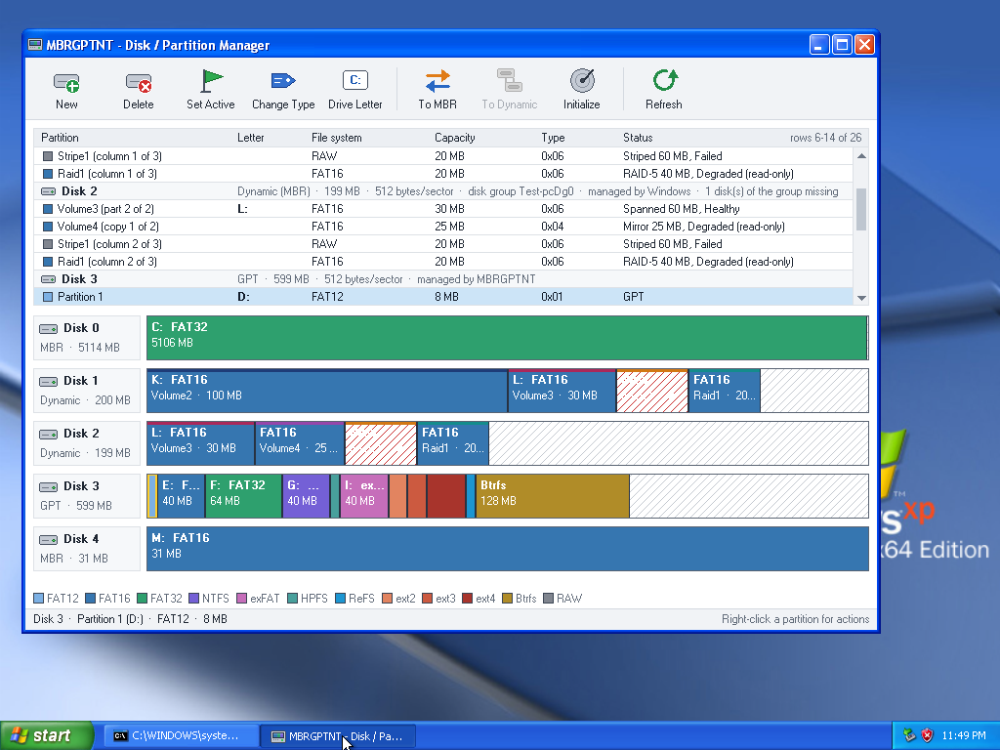
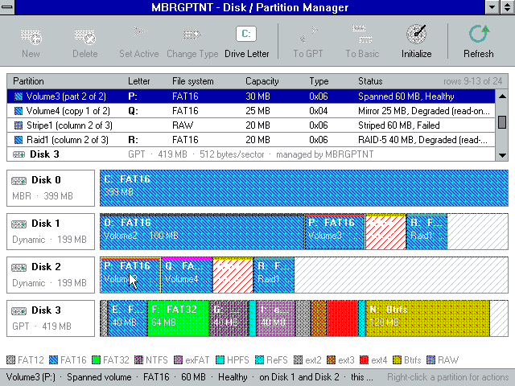
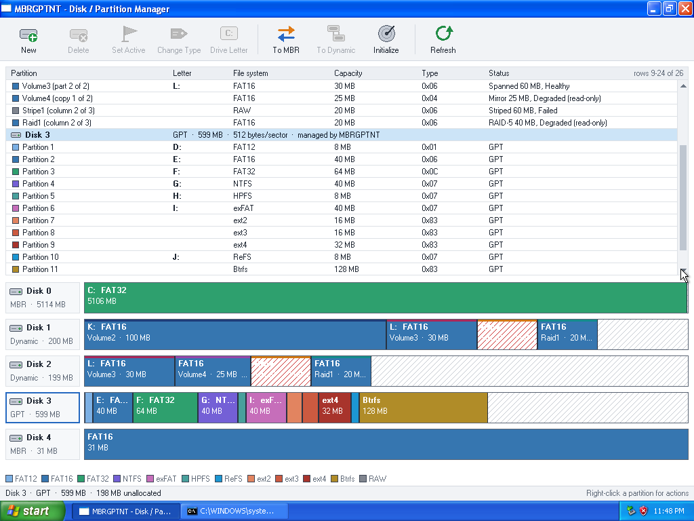
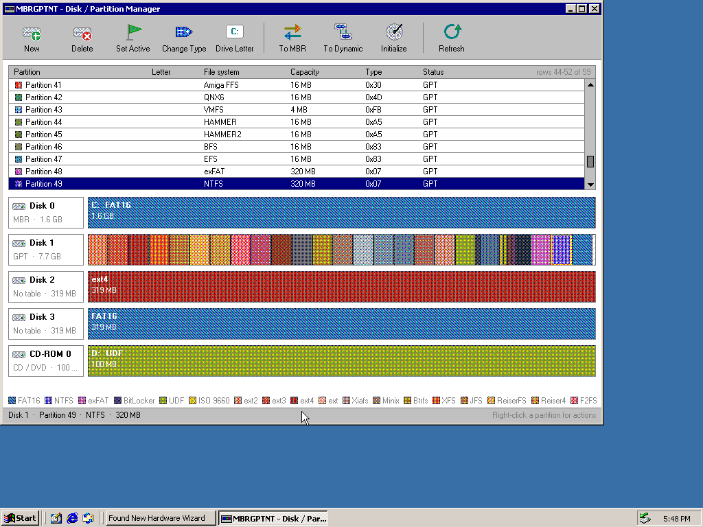
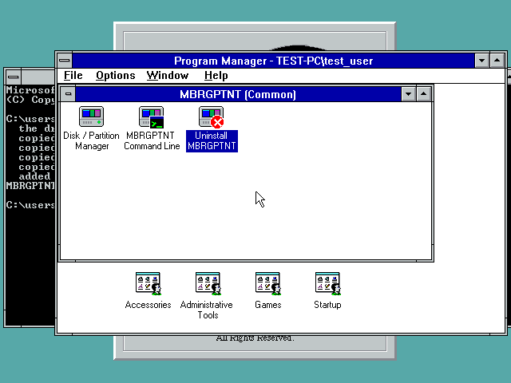
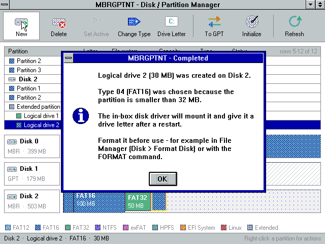
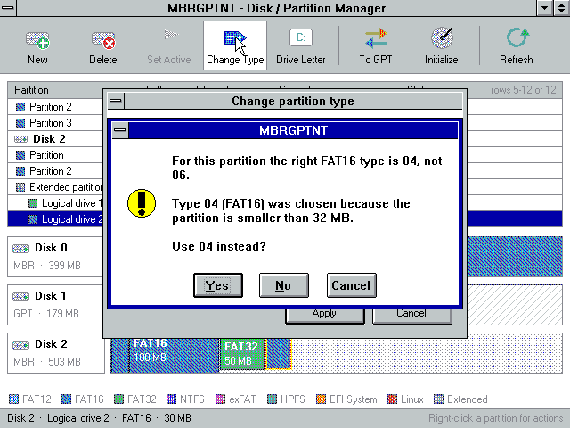
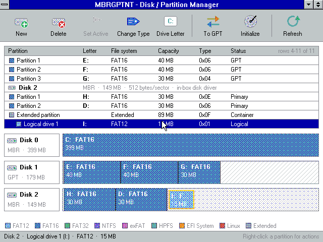
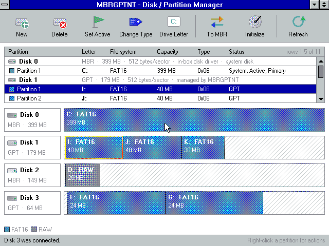
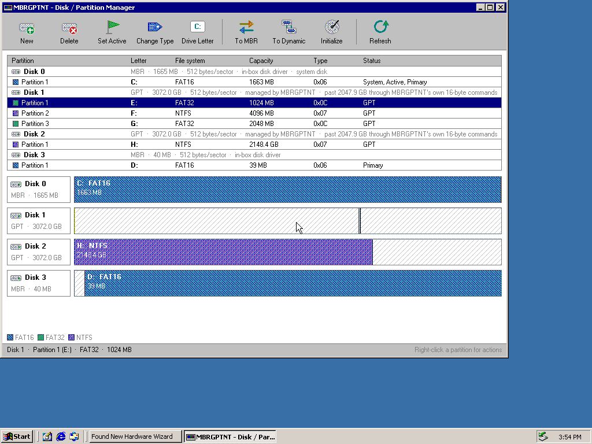

# MBRGPTNT

**MBR, GPT and dynamic disk (LDM) support for Windows NT 3.1, 3.5, 3.51, 4.0,
2000 and XP — 32-bit (i386) and x64.**

MBRGPTNT is a kernel driver and a set of tools that make the partitions of
GPT disks and the volumes of dynamic disks visible to these releases (which
otherwise understand only MBR basic disks), give each a drive letter, and
let you **view and edit** partition tables and disk groups: create, delete,
change type, set the active flag, reassign drive letters, convert
losslessly between GPT and MBR and between basic and dynamic, and create
simple, spanned, striped, mirrored and RAID-5 volumes — from a command-line
tool or a graphical Disk / Partition Manager. One source tree builds every
binary; the i386 driver runs unchanged on all 32-bit releases.



| | |
|---|---|
|  |  |
| Dynamic disks on Windows NT 3.1: simple, spanned, mirrored, striped and RAID-5 volumes across MBR and GPT disks, one disk missing | Eleven file systems told apart on a GPT disk (Windows XP x64) |

## Contents

- [Highlights](#highlights)
- [Supported releases](#what-each-release-gets)
- [Quick start](#quick-start)
- [What it does](#what-it-does)
- [Dynamic disks (LDM)](#dynamic-disks-ldm)
- [Package contents](#package-contents)
- [Installing](#installing)
- [Using the tools](#using-the-tools)
- [Building (on Linux)](#building-on-linux)
- [Validation](#validation)
- [Layout of the sources](#layout-of-the-sources)

## Highlights

- **GPT** disks read and written on Windows NT 3.1 – XP, at 512, 1024,
  2048 and 4096-byte sectors.
- **Dynamic disks**: simple, spanned, striped, mirrored and RAID-5 volumes
  on MBR and GPT disks, degraded mirror / RAID-5 reads, full disk group
  management on NT 3.x / 4.0. Disk groups move between MBRGPTNT and
  Windows in both directions.
- **Complete MBR editing**: primaries, extended containers, logical drives,
  the right type byte chosen for you; partitions the in-box NT 3.x / 4.0
  disk driver ignores are mounted.
- **Lossless GPT <-> MBR conversion** without moving data.
- **File-system detection**: 64 kinds - Windows, Linux (current and old),
  Apple, BSD / Unix, optical (ISO 9660, UDF) and more; CD / DVD drives
  and disks without a partition table are shown too.
- **Disks past 2 TiB on 32-bit Windows**: the whole disk, through
  MBRGPTNT's own 16-byte SCSI commands (AHCINT, SCSI cards).
- **Hot-plug**: USB disks and card readers come and go while Windows runs.
- **A graphical manager that runs on NT 3.1** and a command-line tool.
- **x64** driver and tools for Windows XP x64 / Server 2003 x64.

## Quick start

1. Download the release archive and unpack it.
2. On 32-bit Windows run `i386\mbrginst.exe`, on x64 Windows
   `x64\mbrginst.exe`, as an Administrator.
3. Restart Windows.
4. Open the **MBRGPTNT** program group (Program Manager on NT 3.x, the
   Start menu on NT 4.0 and later) and start **Disk / Partition Manager**,
   or type `mgptgui` / `mgptpart` — the tools are copied to `System32`, so
   they are on the PATH. **Uninstall MBRGPTNT** in the same group removes
   everything again.

## What it does

* **View** every disk and its partitions as a color-coded, proportional
  bar (GPT or MBR, including logical drives in an extended partition, and
  the pieces of dynamic volumes).
* **GPT support**, read and write: enumerate a GPT disk, publish each
  partition as a volume with a drive letter, and read/write files on it.
  Primary GPT with automatic backup-header fall-back on corruption.
* **Dynamic disks (LDM)**, read and write, on MBR and GPT disks and on
  disk groups that mix the two: simple, spanned, striped, mirrored and
  RAID-5 volumes are mounted with drive letters; a mirror or RAID-5 volume
  with one disk missing stays readable (degraded, read-only). Disks made
  dynamic by Windows 2000 / XP / Vista and later are read, and disk groups
  made by MBRGPTNT are imported by Windows (see
  [Dynamic disks](#dynamic-disks-ldm)).
* **Full table editing** for GPT and MBR: create a partition (auto-placed
  or at an explicit offset — primaries, an extended container, and logical
  drives inside it), delete one, change the type, set the active (boot)
  flag, reassign a drive letter, or wipe a disk and start an empty GPT or
  MBR. Both the primary table and the GPT backup / MBR EBR chain are
  written correctly.
* **Disk group management**: convert a basic disk to dynamic (its
  partitions become simple volumes and keep their data and letters) and
  back, create and delete volumes of every layout across the group's disks,
  change a volume's letter.
* **Drive letters** are shown for every partition and volume and assigned
  from the first free letter upward (C, D, E, ...). A letter can be
  reassigned (except the running system partition's), and the letters
  update live after a change.
* **Lossless GPT <-> MBR conversion**: switch a disk between the two
  partitioning schemes while keeping every partition at the same start and
  length — only the table format changes, no data is moved. When it cannot
  be done losslessly (no room for the GPT headers at the disk ends, a
  partition beyond MBR's 2 TiB limit, no gap for a logical drive's boot
  record, a dynamic disk, or the running system disk) the operation is
  refused and the reason is shown.
* **File-system detection**: the File system column names what is really
  on a partition or volume, read from the volume itself rather than guessed
  from the type byte — also through the volume mapping of dynamic volumes:
  - Windows: FAT12, FAT16, FAT32 (by cluster count, as Microsoft's
    specification defines it), NTFS, exFAT, ReFS, HPFS, BitLocker
  - Linux: ext2, ext3, ext4, the original ext, Btrfs, XFS, JFS, ReiserFS,
    Reiser4, F2FS, NILFS2, bcachefs, GFS2, OCFS2, SquashFS, cramfs, EROFS,
    romfs, JFFS2, Minix, Xiafs, Linux swap, LUKS, LVM2, Linux RAID (md 0.90
    - 1.2)
  - Apple: HFS, HFS+, HFSX, APFS, MFS, Core Storage, Apple boot
  - BSD / Unix: UFS, UFS2, ZFS, HAMMER, HAMMER2, BSD swap, System V, Xenix,
    UnixWare BFS, SGI EFS, VxFS, QNX6
  - optical and others: UDF (all versions, 512 - 4096-byte blocks), ISO
    9660, BeFS, Amiga FFS, VMFS, BIOS boot, EFI System

  When a GPT partition holds no recognisable file system, its type GUID
  still names it (Linux swap / LVM / RAID / LUKS, Apple HFS+ / APFS / boot
  / Core Storage, FreeBSD UFS / ZFS / swap, Solaris ZFS, BIOS boot); on MBR
  the type byte does (82 swap, 8E LVM, FD RAID, 83 Linux). Anything else is
  shown as **RAW**; GPT reserved (MSR) and LDM database partitions are
  named as such. A disk with no partition table but one file system over
  all of it (a superfloppy, an ISO or UDF image, a whole-disk ext4 / XFS /
  LUKS) is shown as such and left alone; Initialize gives it a table.
  **CD / DVD drives** are listed too, with the file system on the disc
  (ISO 9660, UDF, HFS, ...), shown only.

   Each kind has its own
  color, and the legend lists the ones present. A partition reformatted
  with another file system may still carry the old one's signatures; the
  boot sector at its start decides (it belongs to the newest file system),
  ReFS needs its full boot-sector header, and UDF needs both its volume
  recognition sequence and an intact anchor at block 256.
* **Disks that come and go**: a disk plugged in after start-up (a USB disk
  or stick, a card in a reader) is picked up within about 2 seconds: its
  partitions get volumes and drive letters, and the manager adds it on its
  own. A disk that is removed loses its volumes and letters, and the
  manager drops it. Swapping one stick for another is noticed too (by the
  disk signature / GPT disk GUID). Dynamic volumes follow their disks: when
  one disk of a mirror is pulled, the mirror comes back from the other disk
  as a degraded, read-only volume. On NT 3.x / 4.0
  this needs a USB storage driver such as
  [USBNT](https://github.com/ages2001/USBNT); there, MBRGPTNT also mounts the
  partitions after the first one on an MBR stick, which the in-box disk
  driver does not.
* **All sector sizes** (512, 1024, 2048, 4096) for basic disks. Offsets
  come from the disk's reported geometry, so a 4Kn disk is handled
  correctly for both reading and writing.
* **x64**: a native x64 driver and x64 tools for Windows XP x64 / Server
  2003 x64, built from the same sources.

### What each release gets


| | NT 3.1 / 3.5 / 3.51 / 4.0 | 2000 / XP (i386) | XP x64 / 2003 x64 |
|---|---|---|---|
| GPT disks | mounted, lettered, editable | mounted, lettered, editable | Windows mounts them; MBRGPTNT edits |
| MBR basic disks | partitions the in-box driver skips are mounted; editable | editable | editable |
| Dynamic disks, MBR | mounted and managed | Windows' LDM driver owns them: **shown** | Windows owns them: **shown** |
| Dynamic disks, GPT only | mounted and managed | mounted and managed (Windows cannot read them) | Windows owns them: **shown** |
| Basic -> dynamic | MBR and GPT | GPT (MBR: Windows' Disk Management) | — (Windows' Disk Management) |

"Shown" means the manager displays the disk group, its volumes, their
layout, state, file system and the drive letters Windows gave them, but
leaves every change to Windows' own Disk Management.

### How enumeration is split

MBRGPTNT layers on top of the in-box disk class driver (it does not
replace it). For each `\Device\HarddiskN\Partition0` it reads the table
and, for the disks it **owns**, publishes `\Device\HarddiskN\PartitionM`
volume objects that forward I/O (with the partition offset added) and a
`\DosDevices\<letter>:` link each.

| Disk | Owned by MBRGPTNT? |
|------|--------------------|
| GPT (any sector size)      | yes — the class driver only sees the 0xEE protective entry |
| MBR, non-512 sector size   | yes — the old class drivers assume 512-byte sectors |
| MBR, 512-byte sectors      | shared — the class driver serves what it can; MBRGPTNT mounts the rest (see below) |

On a 512-byte MBR disk MBRGPTNT asks the in-box class driver which ranges it
actually has volumes for (it walks the class driver's
`\Device\HarddiskN\PartitionM` devices and reads each one's partition
information) and publishes a volume, with a drive letter, for every data
partition the class driver does not serve. On Windows NT 3.1 that is, for
example, a `0E` FAT16 partition (the class driver creates a device for it but
does not mount or letter it), a `0B` / `0C` FAT32 partition, and every logical
drive inside an `0F` extended partition (NT 3.1 does not follow `0F` at all).
On releases whose class driver handles these types, nothing extra is
published. The same mechanism makes changes on such disks live: a partition
created on a running system is published and lettered at once (the class
driver takes it over at the next restart), and a deleted one loses its letter
at once.

Dynamic volumes get devices of their own, `\Device\MbrGptNtDm<n>`, which
map each request onto the member disks (see below).

Table **editing** works on **every** basic disk regardless of ownership: the
tools write the on-disk GPT/MBR through the control device. Owned disks are
updated live (new partitions published and lettered, removed ones dropped;
only a removed partition whose volume is mounted stays until it is closed);
other disks are picked up by the class driver at reboot — on Windows 2000
and later the disk driver is told to read the new table at once. The viewer
always reads the disk, so it reflects the new layout immediately either way.

## Dynamic disks (LDM)

A dynamic disk keeps a database (the Logical Disk Manager database) that
describes every volume of its **disk group**: in the last megabyte of an MBR
disk (partition type `42`), or in the LDM metadata partition of a GPT disk.
MBRGPTNT reads that database from all disks, assembles the groups (the
newest copy wins), and for each volume that can be read with the disks
present publishes a device and a drive letter — the letter the database
asks for when it is free, else the first free one.

| Volume | Layout | With one disk missing |
|---|---|---|
| Simple  | one extent | — |
| Spanned | extents one after another, on one or more disks | failed |
| Striped | 64 KB stripes across 2 or more disks | failed |
| Mirror  | the same data on 2 disks | **degraded**: read from the other copy, read-only |
| RAID-5  | stripes with rotating parity (left-symmetric) on 3 or more disks | **degraded**: missing data rebuilt from parity, read-only |

Reads and writes that fall into one stripe or one extent are passed straight
to the member disk; the rest (stripe-crossing requests, mirror writes,
RAID-5 with its parity update) are split, assembled and computed by the
driver. FORMAT works on dynamic volumes; the type byte it sets is stored in
the volume's database record.

**Changing a disk group** (NT 3.x / 4.0 for every group; on 2000 / XP i386
for groups whose disks are all GPT): every change is made to a fresh copy of
the database, read from the newest disk, and written to every disk of the
group — so all of them must be present.

* **Basic -> dynamic.** MBR: the disk's primary partitions become simple
  volumes in place, keeping their data and drive letters (as Windows 2000
  does, their MBR entries are kept with type `42`); the database goes into
  the last megabyte, which must be free (it is on any disk partitioned by
  Windows or MBRGPTNT). A disk with logical drives is refused. GPT: the
  database goes into an LDM metadata partition taken from the end of the
  Microsoft reserved partition (or from free space), the data partitions
  become simple volumes inside one LDM data partition. The disk joins the
  MBRGPTNT-managed disk group, or starts a new one named after the computer
  (`<Computername>Dg0`, as Windows names it).
* **New volume**: simple, spanned, striped, mirrored or RAID-5, on the
  disks you choose. A new RAID-5 volume is cleared first so that its parity
  is right; every other new volume has its first megabyte cleared so that
  no old file system shows up in it.
* **Delete volume**, **change letter** (also stored in the database, so it
  is kept at the next start), **dynamic -> basic** (for a disk with no
  volumes left; the reserved partition gets its megabyte back).

**Moving disks between systems.** Disk groups made by MBRGPTNT are imported
by Windows as foreign disks. Tested: a group of two MBR disks and one GPT
disk made on NT 3.1 (with volumes converted from basic partitions on both
kinds of disks, spanned, striped, mirrored and RAID-5 volumes) imported into
Windows XP x64 with every file intact, and a group made by Windows 2000 —
changed on NT 3.1 by adding a volume — imported back into Windows 2000.

### Notes and limits (dynamic disks)

* The client editions of Windows (2000 Professional, XP Professional) do not
  support mirrored and RAID-5 volumes and show them as *Failed* when they
  import a group; the Server editions use them. MBRGPTNT itself reads and
  writes all five layouts.
* A degraded mirror or RAID-5 volume is read-only, and so is a group with a
  missing disk (no volume can be created, deleted or changed until the disk
  is back). MBRGPTNT does not rebuild a mirror or RAID-5 volume on a new
  disk; use Windows' Disk Management (Server editions) for that.
* A new mirrored volume starts unsynchronised (only its first megabyte is
  cleared): its two copies hold the same data for everything written
  through it, which is what Windows' resynchronisation would give.
* The disk driver of NT 3.x / 4.0 reaches a disk only up to its last whole
  cylinder. Windows 2000 and later put the dynamic disk database at the very
  end of the disk; when part of a disk's database lies past that cylinder,
  MBRGPTNT reads the database from the other disks of the group and leaves
  that disk's (older) copy alone when it writes — Windows takes the newest
  copy. Disks made dynamic by MBRGPTNT keep the database within reach.
* Database updates are not journaled: every disk's copy is rewritten as a
  whole. Do not power off while a disk group is being changed.
* Up to 4 disk groups, 32 disks per group and 64 volumes per group.

### Notes and limits (general)

* The running system / boot partition is protected: the driver refuses to
  delete it or to wipe or convert its disk while the system is running. It
  is found by resolving \SystemRoot to the real \Device\HarddiskN\PartitionM
  the OS runs from (any disk, any partition number), plus the active
  partition on that system disk.
* Every table-changing operation asks for confirmation first and reports
  progress and result.
* When a partition or volume is deleted while it is mounted, MBRGPTNT locks
  and dismounts it first (as FORMAT does). If no file on it is open, its
  drive letter goes at once; if a file is open (for example a command
  prompt's current directory), the volume stays usable until that file is
  closed, and goes within about 2 seconds after that. A deleted volume's
  device object is only removed once nothing references it (deleting a
  referenced device would bugcheck the old kernels); until then it refuses
  all access.
* When a disk is unplugged, its volumes lose their drive letters at once,
  even if a file on them was open (the data behind it is gone anyway).
  Programs that still hold such a file get errors. Close files and wait
  for the writes to finish before pulling a disk, as with any removable
  disk on these releases.
* The manager and the driver check the disks every 2 seconds. On Windows
  2000 / XP the manager also reacts to the system's device-change message
  at once. NT 3.x File Manager reads its drive list only when it starts, so
  reopen it to see new letters; NT 4.0 and later update by themselves.
* Windows 2000 / XP: "Safely Remove Hardware" does not know about the
  volumes MBRGPTNT publishes for a GPT USB disk, so it does not flush them.
  Close the files on them first. A table changed on a *removable* disk (a
  USB stick) is read again by Windows when the stick is plugged in again.
* An extended partition that still holds logical drives cannot be deleted;
  delete the logical drives first.
* On a GPT disk, "change type" sets the partition's GPT type GUID, but the
  manager shows the actual filesystem it finds in the volume boot record,
  so changing the type of a formatted volume keeps showing that filesystem.
* Converting a 512-byte disk from GPT to MBR hands it back to the in-box
  class driver, which assigns its letters at the next reboot; converting to
  GPT (or any non-512 disk) is re-enumerated live with letters at once.
  File Manager is sent a device-change broadcast after a change; on the
  older releases press F5 if it does not refresh on its own.
* **Disks larger than 2 TiB.** Sector numbers and sizes are 64-bit
  throughout (driver, console and manager), sizes show in the largest unit
  they fill (1024 MB and more as GB, 1024 GB as TB, 1024 TB as PB), and
  a disk's size is taken from the disk itself (`IOCTL_DISK_GET_LENGTH_INFO`,
  else partition 0's length) rather than from the cylinder count, so the
  GPT backup lands on the real last sector. On Windows XP x64 the whole
  disk is Windows' own. NT 3.x - XP i386 read and write with 32-bit sector
  numbers and stop at 2 TiB (with 512-byte sectors); there MBRGPTNT asks
  the disk for its real size (READ CAPACITY(16)) and reaches the rest
  itself with READ(16) / WRITE(16) through the disk driver's SCSI
  pass-through, so behind a controller driver that carries 16-byte
  commands (AHCINT, SCSI cards) the **whole disk** is used: GPT initialize,
  partitions anywhere, volumes past and across 2 TiB with drive letters,
  formatted and written by Windows. The disk row says "past 2047.9 GB
  through MBRGPTNT's own 16-byte commands". Where that path is not there
  (IDE / ATA disk drivers), the part out of reach is hatched, partitions
  reaching into it get no drive letter, the table is not rewritten (a GPT
  written there would describe only 2 TiB) and a blank disk is offered MBR
  only. Dynamic disks are not extended this way. MBR partitions end at
  sector 2^32 - 1, the most an MBR entry holds.
  Seen under emulation: Windows XP x64's IDE driver (atapi) cuts such a
  disk's size to the low 32 bits; XP x64 then mounts partitions at wrong
  places and rewrites the GPT backup copy inside the disk by itself. Use
  disks past 2 TiB on XP x64 only behind a controller driver with 64-bit
  sector numbers.
* Which file system driver mounts a volume is decided by the file system
  drivers, not by MBRGPTNT: Windows offers a new volume to each installed
  file system in turn and the first that accepts it wins. A partition
  that still carries an older file system's structures (UDF's recognition
  sequence survives a ReFS or NTFS format, for example) can be taken by
  the wrong driver. Wipe the start of a partition before reformatting it
  with a different file system on another system.
* Booting NT *from* a GPT or dynamic disk needs a loader that understands
  it and is out of scope here; MBRGPTNT is a boot-capable (system-start)
  driver but the firmware/loader side is separate.

## Package contents

```
i386/               Windows NT 3.1, 3.5, 3.51, 4.0, 2000, XP (32-bit)
  mbrgptnt.sys        the driver (one binary for all of these releases)
  mbrginst.exe        installer: copies the driver and tools, registers the service,
                      adds the MBRGPTNT program group
  mbrgunin.exe        uninstaller
  mgptpart.exe        command-line tool
  mgptgui.exe         graphical Disk / Partition Manager
  nt31/ nt35/ nt40/   the same driver with subsystem 3.10 / 3.50 / 4.00 (optional)
x64/                Windows XP x64 / Server 2003 x64
  mbrgptnt.sys        the x64 driver
  mbrginst.exe  mbrgunin.exe  mgptpart.exe  mgptgui.exe   x64 builds of the tools
src/                driver and shared sources (one source for both architectures)
tools/              build scripts, tool sources, the icon and its generator
tests/              Linux test harnesses for the portable cores
docs/               screenshots
```

## Installing

On the target machine, from the `i386` folder (32-bit Windows) or the `x64`
folder (x64 Windows), run `mbrginst` as an Administrator. It copies
`mbrgptnt.sys` into `%SystemRoot%\System32\Drivers`, copies the tools
(`mgptgui.exe`, `mgptpart.exe`, `mbrginst.exe`, `mbrgunin.exe`) into
`%SystemRoot%\System32` so they are on the PATH, creates the service
`HKLM\SYSTEM\CurrentControlSet\Services\mbrgptnt` (kernel driver, system
start), and adds the **MBRGPTNT** program group — a common group in
Program Manager on NT 3.x, a Start menu folder on NT 4.0 and later — with
these items:

| Item | Runs |
|---|---|
| Disk / Partition Manager | `mgptgui.exe` |
| MBRGPTNT Command Line | a command prompt that shows `mgptpart`'s commands |
| Uninstall MBRGPTNT | `mbrgunin.exe` |

Reboot to load the driver. Installing over an earlier version works while
that version runs: the files in use (its driver, a running manager) are
replaced at the next restart.



**Uninstalling.** *Uninstall MBRGPTNT* (or `mbrgunin`) asks for
confirmation, then removes the program group, the service and the files;
the files in use are deleted at the next restart. The data on the disks is
not touched — after the restart, GPT partitions and dynamic volumes that
only MBRGPTNT can mount are simply no longer visible.

Use the x64 installer on x64 Windows: a 32-bit program there is redirected
away from the real `System32`. XP x64 / 2003 x64 load the unsigned driver
(they do not enforce driver signing).

The same i386 `mbrgptnt.sys` works on NT 3.1, 3.5, 3.51, 4.0, 2000 and XP —
its imports are all exported by every one of those kernels and the
structures it uses are identical across them. The per-subsystem builds under
`i386/nt31`, `nt35` and `nt40` are provided only if you prefer an exact
subsystem-version match.

## Using the tools

### Graphical — `mgptgui`

A plain-USER32/GDI window (no ListView / common controls, so the one binary
runs on NT 3.1 too), laid out like a modern disk manager:

* an **icon toolbar** — New, Delete, Set Active, Change Type, Drive
  Letter, Convert (To GPT / To MBR), To Dynamic / To Basic, Initialize,
  Refresh — with actions that do not apply to the selection greyed out;
* a **partition table** (Partition, Letter, File system, Capacity, Type,
  Status) and a **disk map** below it, each partition drawn in its
  filesystem color with its drive letter and size;
* **dynamic disks** shown as "Dynamic (MBR)" / "Dynamic (GPT)" with their
  disk group (and whether Windows manages it, or a disk of the group is
  missing); each volume piece is listed by volume name and position
  ("Volume3 (part 1 of 2)", "Raid1 (column 2 of 3)", "Volume4 (copy 1 of
  2)") with the volume's layout, size and state (Healthy, Degraded
  (read-only), Failed). In the disk map a colored band marks the layout,
  a failed volume is hatched, and selecting a piece highlights every other
  piece of the same volume on the other disks;
* a **scroll bar** on the table when the rows do not fit (arrows, page
  clicks and a draggable thumb), the mouse wheel on NT 4.0 and later, and
  keyboard navigation: Up / Down, Page Up / Page Down, Home / End (the
  table follows the selection), Del, F5;
* a right-click **context menu** and a status bar;
* **automatic refresh**: a disk plugged in or removed, or a change made by
  another program (for example `mgptpart`), shows up within about 2
  seconds, and the status bar says which disk was connected or removed.

Each operation opens its **own dialog** for its values: Create partition
(FAT16 / FAT32 / NTFS / Extended / ... from a list - the exact type byte is
chosen for you - or a byte in hex; size with a KB / MB / GB / TB / PB unit), Create
dynamic volume (layout, size, and the disks to use, with each disk's free
space), Change type (pre-filled with the partition's current type), Change
drive letter (free letters only), Initialize (GPT or MBR), and confirmation
dialogs for Delete, Set Active, Convert and To Dynamic / To Basic. After
every operation a **result box** says what happened (the new drive letter,
the old and new type, why a conversion was refused, ...). The running system
partition and disk are protected and their actions are disabled.

| | |
|---|---|
|  |  |
| The result box after creating a partition | Change Type suggests the right member of the FAT family |
|  |  |
| `0E` and logical drives in an `0F` container mounted on NT 3.1 | A USB stick plugged in while NT 3.1 runs (with USBNT) |

The manager's icon, drawn in the 16 VGA colors for NT 3.x / 4.0 and with
32-bit color for XP (from left: 16, 32 and 48 pixels):


### Command line — `mgptpart`

```
mgptpart list                       list all disks (DynM / DynG = dynamic MBR / GPT)
mgptpart show    <disk>|cd<n>       show a disk's partitions, a dynamic disk's volume pieces,
                                    or the file system on the disc in CD / DVD drive n
mgptpart init    <disk> gpt|mbr     wipe and start an empty table
mgptpart create  <disk> <type> [size] create a partition (fat16|fat32|ntfs|ext or a hex byte;
                 size in MB, or with KB/MB/GB/TB/PB: 500, 750GB, 2TB; omitted = fill)
mgptpart delete  <disk> <index>     delete a partition
mgptpart settype <disk> <index> <type>  change a partition's type
mgptpart active  <disk> <index> on|off   set/clear the active (boot) flag
mgptpart letter  <disk> <index> <C-Z>    reassign a partition's drive letter
mgptpart convert <disk> gpt|mbr          convert the table losslessly
mgptpart rescan                     look for disks plugged in / removed now, then list

dynamic disks:
mgptpart volumes                    disk groups, their disks (free space) and volumes
mgptpart dynamic <disk>             make a basic disk dynamic
mgptpart basic   <disk>             make an empty dynamic disk basic again
mgptpart vcreate simple|spanned|striped|mirror|raid5 <MB> <disk>[:<MB>] ...
                                    new volume; MB per disk, 0 = as large as possible
mgptpart vdelete <volume|X:>        delete a volume (by name, e.g. Volume2, or letter)
mgptpart vletter <volume|X:> <C-Z|none>  change a volume's drive letter
```

For example `mgptpart vcreate raid5 100 1 2 3` makes a RAID-5 volume of
200 MB from 100 MB on each of disks 1, 2 and 3, and `mgptpart vcreate
spanned 0 1:30 2` spans 30 MB of disk 1 and all the free space of disk 2.

Type bytes: `01` FAT12, `04` FAT16<32M, `05`/`0F` extended, `06` FAT16,
`0E` FAT16 (LBA), `07` NTFS/HPFS/exFAT, `0B`/`0C` FAT32, `42` dynamic disk,
`83` Linux, `EF` EFI System. On a GPT disk the byte selects the partition's
GPT type GUID.

When creating a FAT16, FAT32 or extended partition (by name, or by typing
any byte of that family) the driver places it first and then picks the
exact byte:

| Family   | Inside the BIOS CHS range          | Past the CHS range |
|----------|------------------------------------|--------------------|
| FAT16    | `04` under 32 MB, otherwise `06`   | `0E`               |
| FAT32    | `0B`                               | `0C`               |
| Extended | `05`                               | `0F`               |

The CHS range is 1024 cylinders of the disk's geometry (about 8 GB with 255
heads; less on disks reported with fewer heads). The rule is applied on every
release: where the in-box disk driver cannot mount the LBA types, MBRGPTNT
mounts those partitions itself. Entries inside the range get real CHS
values, so DOS / Windows 9x can use them too.

## Building (on Linux)

Requires LLVM (`clang`, `lld-link`, `llvm-dlltool`, `llvm-nm`, `llvm-rc`)
and `python3` with `pefile` (and Pillow, only to redraw the icon).

```
tools/build.sh all          # driver: nt31 / nt35 / nt40 (i386) and x64
tools/buildtools.sh         # i386 mgptpart.exe, mgptgui.exe, mbrginst.exe -> build/tools
tools/buildtools.sh x64     # x64 builds of the tools -> build/tools64
python3 tools/mkicon.py tools/mgptnt.ico               # redraw the icons (16 VGA colors + 32-bit)
python3 tools/mkicon.py tools/mgptcon.ico - console     #   badges: console, install, uninstall
python3 tools/mkicon.py tools/mgptins.ico - install
python3 tools/mkicon.py tools/mgptuni.ico - uninstall
```

Import libraries are generated from each binary's own undefined symbols,
so only the LLVM tool-chain is needed — not the NT DDK. The i386 driver
targets the 486 ISA (no CMOV / P6 opcodes) so it runs on 486 /
original-Pentium machines as well as newer CPUs; it uses no compiler helper
routines (64-bit division is done in code), since NT 3.1 exports none. The
x64 build uses the same sources: `ddknt.h` carries both structure layouts,
checked at compile time.

Portable-core tests (run natively on Linux):

```
cc -std=gnu11 -Isrc -o tstwrite tests/tstwrite.c src/gptcore.c   # create/write round-trip
cc -std=gnu11 -Isrc -o tstconv  tests/tstconv.c  src/gptcore.c   # lossless GPT<->MBR convert
cc -std=gnu11 -Isrc -o tstchs   tests/tstchs.c   src/gptcore.c   # type-byte choice + CHS fields
cc -std=gnu11 -Isrc -o tstebr   tests/tstebr.c   src/gptcore.c   # EBR chain after delete / create
cc -Isrc -o tstldm  tests/tstldm.c  src/ldmcore.c src/gptcore.c  # read a disk group, dump / write its volumes
cc -Isrc -o tstldmw tests/tstldmw.c src/ldmcore.c src/gptcore.c  # build a group with every layout
cc -Isrc -o tstfs   tests/tstfs.c   src/gptcore.c   # file-system detection on an image
cc -Isrc -o tstbig  tests/tstbig.c  src/gptcore.c   # a disk past 2 TiB, full and through 32-bit sector numbers
```

`tstldm OUTDIR disk.img... [-miss N]` lists a disk group's disks and
volumes and writes every volume out through the volume mapper, optionally
pretending disk N is missing (degraded reads).

`tests/tstioctl.c` is a Win32 console program (built like the tools, see
`tools/buildtools.sh`): `tstioctl X:` prints what a volume answers to the
size and position requests file systems send.

## Validation

Verified end to end under emulation:

* **NT 3.1 SP0** — driver load; GPT read/write; full MBR table editing
  (init, primaries, extended + auto-placed logical drives, change type,
  set active); drive letters shown and assigned from the first free letter
  up; drive-letter reassignment (system partition refused); lossless
  GPT <-> MBR conversion round-trip with partition offsets preserved;
  file-system detection (FAT12/16/32, NTFS, HPFS, exFAT, ReFS, UDF,
  ext2/3/4, Btrfs and RAW on one disk; UDF with 512 - 4096-byte blocks;
  ReFS formatted over UDF and the other way round) in both the console and the graphical
  manager; `mbrginst` install over a running version, the program group
  and its items, `mbrgunin` uninstall; a FAT16 volume on a GPT disk with
  2,400 files in 42 folders (0 bytes to 6 MB) copied within the volume,
  partly deleted and checked on the host (`fsck`, checksums); the volume
  size and position requests of Windows 2000 / XP answered per volume.
* **NT 3.1 SP0, dynamic disks** — a group with all five layouts: files read
  and written on each volume (checked on the host, also with each disk in
  turn left out: mirror copies and RAID-5 parity consistent); volumes
  deleted, mirrored and RAID-5 volumes created, formatted and filled from
  the GUI and the console; letters changed; an MBR disk with a FAT16
  partition, an empty MBR disk and a GPT disk with a FAT16 partition
  converted to dynamic into one group (both partitions kept their data and
  letters) and spanned / mirrored / striped / RAID-5 volumes created across
  them; a group made by Windows 2000 (a volume converted from a basic
  partition, simple, spanned and striped volumes) mounted with Windows'
  letters, a volume added to it, the group imported back into Windows 2000;
  a group with a disk missing shown and mounted degraded.
* **File systems** — each made by its own tools on Linux (mkfs.ext2/3/4,
  mkfs.xfs, mkfs.jfs, mkreiserfs, mkfs.reiser4, mkfs.f2fs, mkfs.nilfs2,
  bcachefs, mkswap, mkfs.btrfs, mkfs.minix, mkfs.hfs / hfsplus, mkfs.gfs2,
  mkfs.ocfs2, mkudffs, cryptsetup (LUKS 1 and 2), mksquashfs, mkfs.cramfs,
  mkfs.erofs, xorriso and makefs (ISO 9660), mkapfs, makefs (UFS1, UFS2),
  genromfs, mkfs.jffs2, pvcreate, mkfs.exfat / ntfs / vfat) or, where no
  tool runs here (md RAID, ZFS, BitLocker, BeFS, VxFS, System V, Xenix,
  Xiafs, the original ext, MFS, Amiga, QNX6, VMFS, HAMMER, HAMMER2, BFS,
  EFS), with its signature written at its place; each detected alone, as a
  whole disk and among 50 partitions of one GPT disk; GPT type GUIDs of
  empty partitions named. On Windows 2000: that disk shown with all 50
  file systems, a whole-disk ext4 and a FAT superfloppy shown as disks
  without a partition table, and a UDF DVD in an IDE drive shown as
  CD-ROM 0 with Windows' drive letter.
* **Disks past 2 TiB** — on the host: GPT disks of 3 TiB (512-byte
  sectors) and 12 TiB (4096-byte sectors) parsed, extended at the end and
  written with the backup on the real last sector (`sgdisk -v`); the same
  3 TiB disk seen through 32-bit sector numbers shows the partitions past
  2 TiB as out of reach and every write is refused. On Windows 2000 with
  AHCINT 1.6 (which reports 2^32 - 1 sectors there) and a 3 TiB disk made
  on Linux: a FAT32 volume wholly past 2 TiB and an NTFS volume across it
  mounted with drive letters, the Linux-written file read, 141 files and
  `ntoskrnl.exe` copied onto both, `chkdsk` clean; a blank 3 TiB disk
  initialized as GPT over its whole size, a 2.1 TiB partition created and
  quick-formatted NTFS by Windows 2000 and filled. Checked on the host:
  `sgdisk -v` clean with the backup on the last sector, `fsck.fat` and
  `ntfsfix` clean, every copied file identical, the NTFS backup boot sector
  (past 2 TiB) identical to the first. On NT 3.1 a GPT disk whose last
  partition ends in the partial last cylinder keeps its volume, and its
  table is not rewritten over that partition's end.

  
* **Windows XP x64** — the x64 driver and tools: the NT 3.1-made mixed
  MBR / GPT group imported by Windows (simple, spanned and striped volumes
  healthy, files identical); MBRGPTNT showing the group as managed by
  Windows with Windows' drive letters, the degraded state with a disk
  missing, and all eleven file systems on a GPT disk; partitions deleted
  and created on a USB disk; hot-plug.
* **NT 3.1 SP0 with USBNT** (QEMU UHCI, USB sticks plugged and pulled while
  running) — a GPT stick gets lettered volumes within 2 s and its files can
  be read and written; pulling it removes the letters and the manager drops
  the disk; an MBR stick with three partitions gets all three lettered (the
  in-box driver serves only the first); pulling a stick while a command
  prompt is in one of its directories; re-plugging; swapping one stick for
  another within 2 s.
* **NT 4.0 SP6** and **Windows 2000** (disk behind AHCINT) — driver load,
  GPT read/write, list/show/create/delete.

The portable cores are checked on Linux: `gptcore` against `sgdisk`- and
`sfdisk`-made images (GPT with backup fall-back, MBR with extended/logical
chains, create/write round-trips at 512- and 4096-byte sectors), `ldmcore`
against disk groups made by Windows 2000, Windows Server 2003 R2 and 2008
R2 (simple, spanned, striped, mirrored and RAID-5, read healthy and
degraded) and against `ldmtool`.

## Layout of the sources

```
src/gptcore.{h,c}   portable GPT + MBR parser and writer, layout editing
                    (CRC-32, backup fall-back, VBR filesystem detection,
                    EBR chain); no OS or CRT dependency
src/ldmcore.{h,c}   portable LDM (dynamic disk) database reader and writer
                    and volume mapper (simple, spanned, striped, mirror,
                    RAID-5 with degraded reads); no OS or CRT dependency
src/ddknt.h         minimal NT DDK subset used by the driver (i386 and x64)
src/mgptdrv.c       the driver (enumeration, I/O forwarding, dynamic
                    volumes, control device)
src/mgptioc.h       control-device IOCTL interface (shared with the tools)
tools/mgptpart.c    command-line tool
tools/mgptgui.c     graphical Disk / Partition Manager
tools/mbrginst.c    installer
tools/mbrgunin.c    uninstaller
tools/pmgroup.h     the program group (Program Manager DDE), shared by both
tools/mkicon.py     draws the icons: the manager's (mgptnt.ico) and, with a badge,
                    the command line's (mgptcon.ico), the installer's
                    (mgptins.ico) and the uninstaller's (mgptuni.ico)
```
